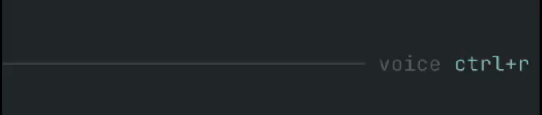

# Pi Voice STT



Provider-agnostic speech-to-text for the [Pi coding agent](https://github.com/earendil-works/pi-coding-agent), with interactive voice dictation and audio file transcription.

Press `Ctrl+R` to record your microphone, press it again to transcribe and insert the transcript into the active prompt, press `Enter` while recording to transcribe and send it directly to chat, or press `Esc` to cancel recording/transcription.

This project is intentionally small and hackable: a Pi extension, local/bridge audio recorders, and OpenAI-compatible/Mistral transcription providers.

## Features

- Pi TUI extension with `/stt` command and `Ctrl+R` shortcut.
- Local audio file transcription with `/stt file <path>` and the `transcribe_audio` agent tool.
- `Enter`-to-send and `Esc`-to-cancel while recording.
- Pi-native animated input indicator, right-aligned in the prompt border (`voice ctrl+r`, `● recording`, `• transcribing`).
- `ffmpeg` microphone capture to temporary WAV files.
- Realtime streaming dictation over AssemblyAI's v3 websocket (`Ctrl+Shift+R`), with a live preview and stable words inserted into the prompt.
- Optional AssemblyAI speaker labels for recorded audio and realtime sessions.
- Optional native Mac microphone bridge for local Pi sessions or Pi sessions running on a VPS over SSH.
- Mistral Voxtral provider.
- OpenAI / Groq / generic OpenAI-compatible provider for hosted and local Whisper-style endpoints.
- Native provider integrations for Deepgram, ElevenLabs Scribe, Gladia, AssemblyAI, and Soniox.
- Environment variable and macOS Keychain secret lookup.
- HTTPS-by-default endpoint policy; plain HTTP is allowed only for loopback hosts.
- TypeScript source loaded directly by Pi; no build step required for runtime.

## Requirements

- Pi `>= 0.75`.
- Node.js `>= 20` when developing locally.
- For microphone capture: `ffmpeg` available in `PATH` or configured with `capture.ffmpegPath` (or the Mac bridge).
- For microphone capture: microphone permission for the terminal app running Pi, or for the Mac bridge daemon when using `capture.type: "bridge"`.
- A transcription backend (Mistral, OpenAI/Groq, Deepgram, ElevenLabs Scribe, Gladia, AssemblyAI, Soniox, or a local OpenAI-compatible server).

## Installation

### From GitHub

```bash
pi install npm:pi-voice-stt
```

Restart Pi or run `/reload`.

GitHub install also works:

```bash
pi install git:github.com/cgarrot/pi-voice-stt
```

### Local development install

```bash
git clone https://github.com/cgarrot/pi-voice-stt.git
cd pi-voice-stt
npm install
npm run ci
pi -e .
```

You can also add the local path to Pi settings:

```bash
pi install /absolute/path/to/pi-voice-stt
```

## Audio file transcription

Insert a local recording's transcript into the current prompt:

```text
/stt file ./meeting.m4a
/stt file "./My recordings/meeting.wav"
```

The command appends to the editor using the existing output formatting and never sends the prompt automatically, even when `output.submitOnStop` is enabled. Spoken keywords such as `send`, `clear` and `new line` are treated as transcript content, not voice commands.

An agent can use the `transcribe_audio` tool:

```text
Transcribe ./meeting.m4a and summarize the decisions and action items.
```

The tool accepts `{ "path": "./meeting.m4a" }` and returns the transcript as its main text, with `text`, `provider`, `model` and the resolved `path` in its result details. It does not change the editor or write a transcript file.

Both entry points use the active profile and mode, including the provider, language, replacements and optional AI cleanup. Use `/stt mode raw` to skip cleanup. Relative paths resolve from the Pi session's working directory; absolute paths and a leading `@` are also accepted. Only readable local files are supported; URLs are not downloaded. Source files are never modified. File transcription does not require a microphone, `ffmpeg`, or the capture bridge.

Supported file extensions: `.wav`, `.mp3`, `.m4a`, `.mp4`, `.aac`, `.flac`, `.ogg`, `.opus` and `.webm`. The original file is uploaded with its filename and matching MIME type, without conversion to WAV. Actual codec/container support depends on the selected provider, model and endpoint, especially for custom OpenAI-compatible servers. `.opus` is sent as an Ogg Opus container (`audio/ogg`). AssemblyAI retains its binary upload endpoint's `application/octet-stream` header.

Audio files are currently sent as a single transcription request. Automatic chunking of long recordings is not implemented yet. Provider upload size and duration limits therefore still apply. A provider rejection includes the provider, file path, file size and the returned error; the extension does not silently retry with another format or provider. Gladia and AssemblyAI retain their existing upload, transcription-job and polling flow for that single file.

The existing provider and cleanup timeouts apply. Cancel with `/stt cancel` or `Esc` in the interactive editor; tool cancellation also aborts the request. Failed or cancelled file transcription leaves the editor unchanged. Only one recording or transcription can run at a time.

## Configuration

Pi Voice STT reads configuration from the first available source:

1. `PI_STT_CONFIG=/path/to/config.json`
2. `~/.pi/agent/stt.json`
3. built-in defaults

The shortcut defaults to `Ctrl+R`. Override it with either:

```bash
PI_STT_KEYBIND=ctrl+shift+r pi
```

or a top-level `keybind` in the config file. Environment wins at startup.

> Note: the keybinding is registered when the extension loads. After changing `PI_STT_KEYBIND` or `keybind`, restart Pi or run `/reload` from a Pi process launched with the new environment.

### Output options

```json
{
  "output": {
    "appendTrailingSpace": true,
    "submitOnStop": false
  }
}
```

- `appendTrailingSpace` (default `true`): append a space after the inserted transcript.
- `submitOnStop` (default `false`): when `true`, stopping a recording with the `Ctrl+R` toggle also sends the transcript to chat (same as pressing `Enter` while recording) instead of only inserting it into the prompt. Hands-free dictation: `Ctrl+R` to start, `Ctrl+R` to stop-and-send, `Esc` to cancel.
- `replacements` (default `{}`): a literal dictionary applied to the raw transcript before cleanup. Case-insensitive and word-boundary aware; longer keys win. Handy for terms the recognizer mishears:

```json
{
  "output": {
    "replacements": { "super base": "Supabase", "react native": "React Native" }
  }
}
```

### Localization

Runtime labels and toasts default to English. Switch them with the top-level `locale` setting (or the `PI_STT_LOCALE` environment variable). Built-in packs: `en` (default) and `fr`.

```json
{
  "locale": "fr"
}
```

Like the keybinding, the locale is resolved when the extension loads — restart Pi or run `/reload` after changing it. A ready-to-copy French config is provided in [`examples/stt.fr.json`](examples/stt.fr.json). The product name is never localized.

### Modes

Modes are named presets that override any part of the configuration. Built-in modes: `default` (no overrides) and `raw` (skips AI cleanup). Define your own under `modes` and switch at runtime with `/stt mode <name>` (or set a default via the top-level `mode` setting / `PI_STT_MODE`).

```json
{
  "mode": "default",
  "cleanup": { "enabled": true, "endpoint": "https://api.openai.com/v1/chat/completions", "model": "gpt-4o-mini", "apiKeyEnv": "OPENAI_API_KEY" },
  "modes": {
    "raw": { "cleanup": { "enabled": false } },
    "commit": { "cleanup": { "language": "en", "prompt": "Rewrite the dictation as a concise, imperative git commit subject line." } }
  }
}
```

A user mode overrides the built-in of the same name. `/stt mode` with no argument prints the active mode and the available list. The mode applies on top of the base config, so it can change the provider, cleanup, language or replacements.

### Profiles

Profiles are named presets that group a full configuration (provider, capture, cleanup, output…), so you can switch models or providers without editing the config file. Unlike modes, profiles persist: the last profile you select becomes the default for every session that reads the same config file.

Define profiles under the top-level `profiles` key. Each profile is a partial config that is deep-merged over the base config, so you only override what differs. The top-level `profile` key sets the initial default before anything is persisted:

```json
{
  "profile": "local",
  "capture": {
    "type": "ffmpeg",
    "ffmpegPath": "ffmpeg",
    "inputFormat": "avfoundation",
    "input": ":0"
  },
  "profiles": {
    "local": {
      "provider": {
        "type": "openai-compatible",
        "endpoint": "http://127.0.0.1:8788/v1/audio/transcriptions",
        "model": "crisperwhisper-large",
        "language": "fr"
      }
    },
    "mistral": {
      "provider": {
        "type": "mistral",
        "model": "voxtral-mini-2602",
        "apiKeyEnv": "MISTRAL_API_KEY",
        "language": "fr"
      }
    }
  }
}
```

When a profile changes the provider or capture `type`, that block is replaced entirely, so the base endpoint/model/apiKey never leak into the new provider.

Press the profile shortcut (default `Alt+R`) to open a menu and pick the profile to use. Override it with the top-level `profileKeybind` setting or the `PI_STT_PROFILE_KEYBIND` environment variable:

```bash
PI_STT_PROFILE_KEYBIND=ctrl+shift+p pi
```

> **Note on `Ctrl+Shift+R`:** Pi's key parser handles the Kitty keyboard-protocol encoding of `ctrl+shift+<letter>` correctly (modifier `6`, `1 + shift|ctrl`), so the combo works as an ordinary keybind on terminals that speak the protocol (kitty, Ghostty, WezTerm, iTerm2). Inside tmux, also run `set -s extended-keys on`. The extension additionally matches the raw CSI-u sequence as a fallback for terminals that forward the protocol without surfacing the key through the normal pipeline.

The selection applies to the next recording. The last selected profile is persisted in a sidecar state file next to your config (`<config path>.profile.json`) and reused as the default for every session. Effective profile resolution: `PI_STT_PROFILE` environment variable > persisted selection > top-level `profile` key > `default` (no overrides).

Commands:

- `/stt profile` — show the active profile and the available list.
- `/stt profile <name>` — switch profile directly.

The active profile is shown in the input-border indicator while idle (`voice · local`). Like modes, profiles apply on top of the base config, and modes then apply on top of the selected profile.

### Realtime streaming (AssemblyAI)

Batch dictation records a file, uploads it and waits for the transcript. Realtime streams raw PCM over a websocket instead: unstable words appear in a live preview, while stable words are inserted into the prompt without rewriting text you have already edited.

```json
{
  "realtime": {
    "enabled": true,
    "keybind": "ctrl+shift+r",
    "model": "universal-3-6-pro",
    "mode": "balanced",
    "formatTurns": true,
    "language": "auto",
    "keyterms": ["Pi", "AssemblyAI"],
    "inactivitySeconds": 0,
    "commitOnTurnEnd": true,
    "insertionPosition": "cursor",
    "capture": {
      "inputFormat": "pulse",
      "input": "default",
      "chunkMs": 100
    }
  }
}
```

- `enabled` — realtime is off until you turn it on. The provider is fixed to AssemblyAI: streaming protocols, auth and message shapes are vendor-specific, and only AssemblyAI is implemented.
- `keybind` — defaults to `ctrl+shift+r` and toggles a session: press to start, press again to finish and insert. `PI_STT_REALTIME_KEYBIND` overrides it.
- `model` / `mode` — sent to the streaming endpoint. `mode` accepts `balanced` or `min_latency`. The default model is `universal-3-6-pro`, AssemblyAI's recommended streaming model; `universal-3-5-pro` and the cost-effective `universal-streaming-english`/`universal-streaming-multilingual` remain valid choices. Note that Universal-3.6 Pro is streaming-only — batch (`provider`) transcription keeps its own model list.
- `formatTurns` — ask the server to punctuate and capitalize finalized turns.
- `language` — `auto` omits the language parameter and lets the model decide; any other value is sent as `language_codes` (comma-separate several).
- `keyterms` — words the model should prefer, sent as a JSON array. Useful for project names and jargon.
- `inactivitySeconds` — server-side inactivity timeout in seconds. `0` disables that timeout; the client still stops after 30 seconds without detected speech.
- `commitOnTurnEnd` — `true` inserts stable words as they arrive (or whole turns when speaker labels are enabled); `false` buffers everything until you stop.
- `insertionPosition` — `cursor` (default) inserts at the current cursor; `end` appends to the prompt.
- `capture` — inherits the top-level `capture` block field by field, so the microphone is configured once. `chunkMs` is the audio frame size (50–1000 ms; `100` is a good default).

Secrets inherit the resolved AssemblyAI `provider` block, so a working batch setup streams without duplicating the API key. Realtime needs the interactive TUI; there is no live text to render in a headless session.

Already inserted words are not rewritten by later provider revisions. You can keep typing while streaming. Cancelling restores the original prompt only if it has not been edited since dictation started; otherwise it preserves your edits and any words already inserted. File transcription and realtime sessions cannot run together.

Commands: `/stt realtime [start|stop|cancel|status]`.

### Speaker labels (AssemblyAI)

Set a top-level `"speakers": 2` to request labels for up to two speakers, or use `/stt speakers` to open a picker. `/stt speakers off` disables labels; `/stt speakers N` accepts 1–10. The runtime choice is saved alongside the selected profile and overrides the config until changed. The default is `0` (off).

Recorded/file transcription adds `Speaker A: …` lines only when multiple speakers were detected. Realtime waits for finalized turns when two or more speakers are configured, since speaker labels arrive at turn end, and adds a label when the speaker changes. Later provider revisions do not rewrite text already inserted. Other batch providers ignore this setting.

### Voice commands

Optionally trigger an action by ending your dictation with a keyword. Disabled by default; keywords are configurable (English by default, override for any language).

```json
{
  "commands": {
    "enabled": true,
    "send": ["send", "send it"],
    "clear": ["scratch that", "delete that"],
    "newline": ["new line"]
  }
}
```

- `send`: strip the keyword and send the prompt to chat (even when `submitOnStop` is off).
- `clear`: discard the current dictation without inserting anything.
- `newline`: insert the text followed by a line break.

The keyword is only detected at the very end of the transcript, ignoring trailing punctuation. Voice commands are parsed before the AI cleanup pass.

### Smart cleanup (AI)

Optionally run the raw transcript through an LLM before it is inserted, to fix punctuation, capitalization, remove filler words and spell project-specific terms correctly. Disabled by default. Because Pi exposes no one-shot inference API, cleanup calls its own OpenAI-compatible chat endpoint (works with OpenAI, Groq, Mistral or a local server), reusing the same secret resolution as the STT providers.

```json
{
  "cleanup": {
    "enabled": true,
    "endpoint": "https://api.openai.com/v1/chat/completions",
    "model": "gpt-4o-mini",
    "apiKeyEnv": "OPENAI_API_KEY",
    "language": "auto",
    "useRepoContext": true,
    "projectTerms": ["Supabase", "HyperFrames"]
  }
}
```

- `enabled` (default `false`): turn the cleanup pass on.
- `endpoint` / `model` / `apiKeyEnv` / `keychainService` / `keychainAccount`: same secret handling as STT providers; HTTPS required unless the endpoint is localhost.
- `language` (default `"auto"`): `"auto"` keeps the spoken language; set e.g. `"fr"` to normalize the output.
- `prompt`: override the base system prompt.
- `projectTerms`: glossary of terms the model should spell correctly (e.g. `"super base"` → `Supabase`).
- `useRepoContext` (default `false`): include the current git branch as context.
- `maxTokens` (default `2000`), `timeoutSeconds` (default `30`).

If the cleanup call fails or times out, the raw transcript is used instead — dictation is never blocked. The indicator shows a distinct `polishing` state during the pass.

### Language detection

Set `provider.language` to a specific code (e.g. `"en"`, `"fr"`) to force a language, or to `"auto"` (or leave it empty) to let the provider detect the spoken language automatically — useful for code-switching (e.g. French with English technical terms). `"auto"` is treated as "no language hint" and is supported by every provider. With AssemblyAI, `"auto"` sends `language_detection` instead of a fixed `language_code`, so the model preference list can route per request.

### Mistral Voxtral

```json
{
  "keybind": "ctrl+r",
  "capture": {
    "type": "ffmpeg",
    "inputFormat": "avfoundation",
    "input": ":0",
    "sampleRate": 16000,
    "channels": 1,
    "maxSeconds": 120,
    "minBytes": 4096
  },
  "provider": {
    "type": "mistral",
    "model": "voxtral-mini-2602",
    "apiKeyEnv": "MISTRAL_API_KEY",
    "language": "fr"
  },
  "output": {
    "appendTrailingSpace": true
  }
}
```

### OpenAI

```json
{
  "provider": {
    "type": "openai",
    "model": "gpt-4o-mini-transcribe",
    "apiKeyEnv": "OPENAI_API_KEY",
    "language": "en"
  }
}
```

You can also use `model: "whisper-1"` or any OpenAI transcription model supported by your account.

### Groq / Whisper

```json
{
  "provider": {
    "type": "groq",
    "model": "whisper-large-v3-turbo",
    "apiKeyEnv": "GROQ_API_KEY",
    "language": "en"
  }
}
```

### Generic OpenAI-compatible endpoint

```json
{
  "provider": {
    "type": "openai-compatible",
    "endpoint": "https://api.openai.com/v1/audio/transcriptions",
    "model": "whisper-1",
    "apiKeyEnv": "OPENAI_API_KEY",
    "language": "en"
  }
}
```

### Deepgram

```json
{
  "provider": {
    "type": "deepgram",
    "model": "nova-3",
    "apiKeyEnv": "DEEPGRAM_API_KEY",
    "language": "en",
    "smartFormat": true
  }
}
```

### ElevenLabs Scribe

```json
{
  "provider": {
    "type": "elevenlabs",
    "model": "scribe_v1",
    "apiKeyEnv": "ELEVENLABS_API_KEY",
    "language": "en"
  }
}
```

### Gladia

```json
{
  "provider": {
    "type": "gladia",
    "apiKeyEnv": "GLADIA_API_KEY",
    "language": "en",
    "pollIntervalMs": 1000
  }
}
```

`"gradium"` is accepted as a compatibility alias for `"gladia"` in case you remember the provider by that name.

### AssemblyAI

```json
{
  "provider": {
    "type": "assemblyai",
    "model": "universal-3-5-pro",
    "apiKeyEnv": "ASSEMBLYAI_API_KEY",
    "language": "auto",
    "pollIntervalMs": 1000
  }
}
```

`model` accepts any current AssemblyAI model name (`universal-3-5-pro`, `universal-2`, …) or a comma-separated preference list. The extension sends the plural `speech_models` array and appends `universal-2` as the fallback tier when you name a single model, which is AssemblyAI's recommended routing. The legacy `universal` alias is mapped to `universal-2`. The singular `speech_model` parameter is deprecated and rejects current model names with HTTP 400.

With `language: "auto"` the provider sends `language_detection` rather than a fixed `language_code`, so the preference list routes per request. Note that detection works best with at least ~15 seconds of audio.

### Soniox

```json
{
  "provider": {
    "type": "soniox",
    "model": "stt-async-v5",
    "apiKeyEnv": "SONIOX_API_KEY",
    "language": "en"
  }
}
```

Get an API key at [console.soniox.com](https://console.soniox.com). Supports `baseUrl` (default `https://api.soniox.com`), `model` (default `stt-async-v5`), `language` (maps to `language_hints`; empty or `"auto"` for auto-detection), `timeoutSeconds` (default `300`), and `pollIntervalMs` (default `1000`).

A ready-to-copy config is provided in [`examples/soniox.json`](examples/soniox.json).

### Local STT server

```json
{
  "provider": {
    "type": "openai-compatible",
    "endpoint": "http://localhost:10301/v1/audio/transcriptions",
    "model": "whisper-1",
    "apiKeyEnv": "",
    "language": "en"
  }
}
```

Plain HTTP is accepted only for `localhost`, `127.0.0.1`, or `::1`.

### Mac native microphone bridge

Use the bridge when direct `ffmpeg` capture cannot receive microphone frames on macOS. The bridge is **opt-in**: it activates only with `capture.type: "bridge"`; the default `ffmpeg` recorder remains unchanged.

> See **[docs/macos-bridge.md](docs/macos-bridge.md)** for architecture, security, troubleshooting, and uninstall details.

**Pi running on this Mac:** install the native loopback bridge. It makes no SSH or `~/.ssh/config` changes.

```bash
tools/install-macos-bridge.sh --local
```

Configure the extension to use its local endpoint and generated token:

```json
{
  "capture": {
    "type": "bridge",
    "endpoint": "http://127.0.0.1:18765",
    "tokenFile": "~/.config/pi-voice-stt-bridge/token",
    "requestTimeoutSeconds": 30,
    "maxSeconds": 120,
    "minBytes": 4096
  }
}
```

**Pi running on a VPS:** run the installer with the SSH alias of the VPS (as configured in `~/.ssh/config`):

```bash
tools/install-macos-bridge.sh my-vps
```

VPS mode installs the daemon, a reverse-SSH-tunnel LaunchAgent, generates a shared bearer token, and adds a `<vps>-voice-tunnel` SSH host with `RemoteForward`. See the installer header for port, node, ffmpeg, and cmux overrides.

**VPS step 2. Copy the token** so Pi on the VPS can authenticate to the tunnel:

```bash
scp ~/.config/pi-voice-stt-bridge/token my-vps:~/.pi/agent/pi-voice-stt-bridge.token
```

**VPS step 3.** Point Pi at the bridge (e.g. `~/.pi/agent/stt.json`):

```json
{
  "capture": {
    "type": "bridge",
    "endpoint": "http://127.0.0.1:18765",
    "tokenFile": "~/.pi/agent/pi-voice-stt-bridge.token",
    "requestTimeoutSeconds": 30,
    "maxSeconds": 120,
    "minBytes": 4096
  },
  "provider": {
    "type": "groq",
    "model": "whisper-large-v3-turbo",
    "apiKeyEnv": "GROQ_API_KEY",
    "language": "fr"
  }
}
```

Run `/stt doctor` in Pi to verify the bridge health. The daemon only accesses the microphone when Pi calls `/start` after `Ctrl+R`; `/stop` returns the WAV to the VPS for transcription by your configured provider. On macOS the installer prefers a tiny native background app (`Pi Voice STT Bridge.app`) so microphone permission works without keeping a terminal open — the first `/start` may trigger a permission prompt.

## Audio capture notes

With `capture.type: "ffmpeg"`, the extension records through `ffmpeg`. Platform defaults are:

| OS | `inputFormat` | `input` |
| --- | --- | --- |
| macOS | `avfoundation` | `:0` |
| Linux | `pulse` | `default` |
| Windows | `dshow` | `audio=Microphone` |

On macOS, list devices with:

```bash
ffmpeg -f avfoundation -list_devices true -i ""
```

Then set `capture.input`, for example `":0"` or `":1"`.

On Linux, you may prefer PulseAudio/PipeWire (`pulse`) or ALSA (`alsa`) depending on your system.

#### "Recording is too small" / "Recording is silent" / no audio captured

Both errors mean the configured audio source produced no usable audio. A **silent** recording (e.g. a virtual device such as ZoomAudioDevice selected instead of the real microphone) is a normal-sized WAV of pure silence, so it passes the size check but transcribes to nothing — providers like ElevenLabs then report an empty transcription (`"did not include text"`). The ffmpeg and bridge recorders both detect silence and report it directly.

To fix it:

1. **Microphone permission** — grant microphone access to the terminal running Pi (System Settings → Privacy & Security → Microphone).
2. **Pick the right source (Linux/PulseAudio).** List sources and target one that actually captures:
   ```bash
   pactl list short sources
   ```
   Then set, for example, `"inputFormat": "pulse", "input": "alsa_input.pci-0000_00_1b.0.analog-stereo"`.
3. **Fallback to ALSA** if the PulseAudio default is empty or suspended:
   ```json
   { "capture": { "inputFormat": "alsa", "input": "default" } }
   ```
   List ALSA devices with `arecord -L` (common inputs: `default`, `hw:0`, `plughw:0`).
4. **macOS** — confirm the device with `ffmpeg -f avfoundation -list_devices true -i ""` and set `capture.input` (e.g. `":1"`). The default `":0"` may be a virtual device (Zoom, BlackHole, OBS) that records silence; pick the index of the real microphone.

You can also lower the threshold with `capture.minBytes` (default `4096`), but a working source should far exceed it. See [docs/macos-bridge.md](docs/macos-bridge.md) for the VPS bridge as an alternative when the VPS has no local microphone.

## Usage

The voice state is displayed inside the input area, right-aligned on the prompt border, so it stays close to where you are typing without taking over the footer/token line. Recording uses a subtle blinking dot; transcription uses a small horizontal moving dot.

| Action | Behavior |
| --- | --- |
| `Ctrl+R` while idle | Start recording |
| `Ctrl+R` while recording | Stop, transcribe, insert transcript into the prompt (or send it directly when `output.submitOnStop` is `true`) |
| `Enter` while recording | Stop, transcribe, insert transcript, send prompt to chat |
| `Esc` while recording/processing | Cancel recording or transcription |
| `Ctrl+Shift+R` while idle | Start a realtime streaming session |
| `Ctrl+Shift+R` while streaming | Finish the session and insert the transcript |
| `Esc` while streaming | Cancel the session; restore the original prompt only if it has not been edited |
| `/stt status` | Show current mode and config source |
| `/stt doctor` | Check config, provider readiness, and local `ffmpeg` or bridge health |
| `/stt start` | Start recording |
| `/stt stop` | Stop and insert transcript |
| `/stt send` | Stop and send to chat |
| `/stt file <path>` | Transcribe a local audio file and append it to the editor |
| `/stt cancel` | Cancel active recording/transcription |
| `/stt mode [name]` | Show or switch the active preset (`default`, `raw`, or your own) |
| `/stt realtime [start\|stop\|cancel\|status]` | Control AssemblyAI realtime streaming |
| `/stt speakers [off\|N]` | Pick or set the maximum AssemblyAI speaker count |

## Secret handling

Prefer environment variables:

```bash
export MISTRAL_API_KEY=...
export OPENAI_API_KEY=...
export GROQ_API_KEY=...
export DEEPGRAM_API_KEY=...
export ELEVENLABS_API_KEY=...
export GLADIA_API_KEY=...
export SONIOX_API_KEY=...
export ASSEMBLYAI_API_KEY=...
```

You can also point at a file containing either the raw key or an env-style line such as `export MISTRAL_API_KEY=...`:

```json
{
  "provider": {
    "type": "mistral",
    "apiKeyFile": "~/.config/opencode/voxtral-stt.env"
  }
}
```

On macOS, you can also use Keychain:

```json
{
  "provider": {
    "type": "mistral",
    "keychainService": "pi-voice-stt",
    "keychainAccount": "your-account"
  }
}
```

The extension calls:

```bash
security find-generic-password -w -s <service> -a <account>
```

You can also retrieve keys from a secret manager (such as `pass`, 1Password CLI, or Bitwarden) by prefixing `apiKey` with `!`:

```json
{
  "provider": {
    "type": "groq",
    "apiKey": "!pass show api/groq"
  }
}
```

Pi Voice STT executes the command on demand when transcription starts and caches the output in memory for the process lifetime.

## Development

```bash
npm install
npm run check
npm test
npm run smoke
npm run ci
```

Project layout:

```text
src/index.ts                 Pi extension entry point
src/core/                    dictation state machine
src/audio/                   ffmpeg and bridge recorders
src/providers/               STT provider abstraction
src/config/                  config loading and validation
src/ui/                      Pi TUI input indicator and editor wrapper
examples/                    ready-to-copy config files
tools/                       optional Mac bridge daemon/installer
```

## Design goals

- Keep provider code independent from Pi so new backends are easy to add.
- Keep the Pi integration thin and readable.
- Match Pi's TUI style by default: compact input-border status instead of a separate footer widget.
- Avoid storing secrets in sessions or config examples.
- Use only Node built-ins at runtime.
- Fail safely: clean up temporary files and stop local or bridged `ffmpeg` on cancel, reload, or exit.

## Contributors

Thanks to everyone who has contributed to Pi Voice STT:

<a href="https://github.com/cgarrot/pi-voice-stt/graphs/contributors">
  
</a>

Made with [contrib.rocks](https://contrib.rocks). Contributions are welcome — see [CONTRIBUTING.md](CONTRIBUTING.md).

## License

MIT
